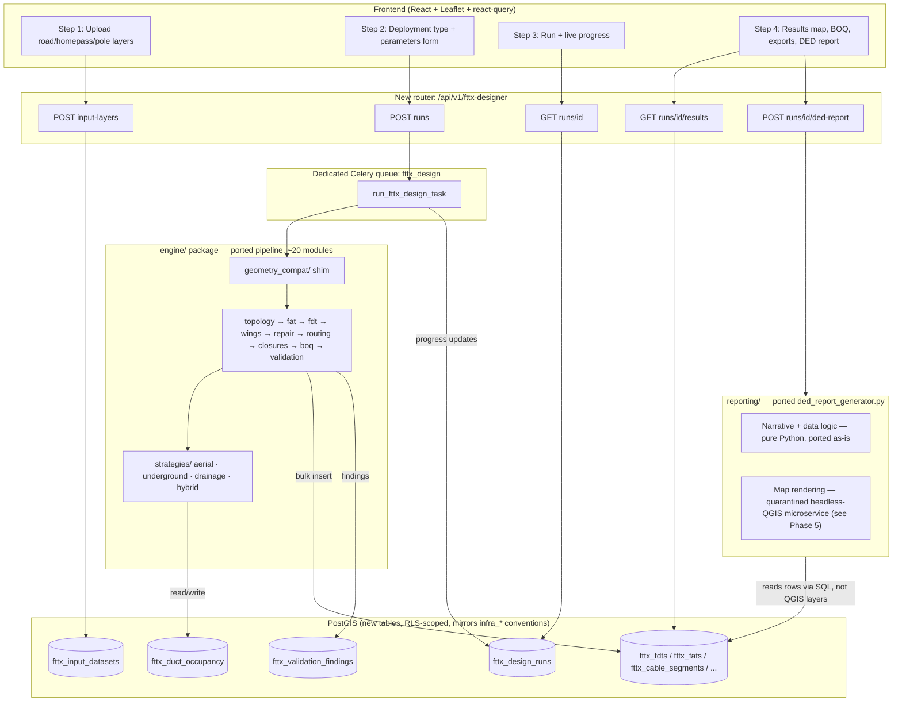

# FTTx Designer → OpSyn Web Integration Plan

**Prepared:** 2026-09-21
**Scope:** Integrating `FTTx Designer — dual PON integrated.py` (standalone QGIS Python script, `c:\Users\David.Onoja\Desktop\FOB\Automation\script\`) into the OpSyn web application (`OpSyn-V1.1`) as a web-triggered, backend-executed automation, following the conventions already established by OpSyn's `infrastructure` module.
**Method:** Direct source inspection of both codebases — the FTTx script (19,302 lines, read section-by-section, dependency-grepped) and OpSyn's `backend/app/modules/infrastructure/` module, its migrations, routers, Celery tasks, RLS policies, and frontend pages (full research report reproduced in evidence form throughout §1–§2). This is a planning document only — no code has been changed as part of producing it.

---

## 0. Executive Summary

The FTTx Designer is a large but **structurally well-behaved** monolith: its QGIS dependency is far shallower than its line count suggests (exactly one call into QGIS's `processing` toolbox in the entire file), its GUI dialog maps almost 1:1 onto a single flat config dataclass, and its heaviest "business logic" — the capacity/wing repair passes — is already isolated by the script's own author into clearly-named functions. OpSyn, on the other hand, already has a proven, RLS-secured, multi-tenant pattern for exactly this shape of problem: **the infrastructure bulk-upload/staging/commit session** (`InfraUploadSession` → `InfraUploadStaging` → committed asset tables → `InfraAuditLog`). That pattern is the template this plan reuses, adapted from a synchronous small-file workflow into an **asynchronous, Celery-driven, long-running design-run workflow**.

The recommended approach, in one sentence: **shim the small QGIS API surface the script actually uses with a Shapely/NetworkX/GeoPandas-backed compatibility layer so the 19k lines of pipeline logic port with minimal rewrite risk, break that file into ~20 focused modules along its own existing internal seams, run it as a dedicated-queue Celery job that writes into new PostGIS-backed tables following the exact RLS/tenant pattern already in place, and expose it through a wizard-style frontend that mirrors the existing upload-wizard UX.**

One material finding surfaced during research that the user should be aware of before scoping work: **CLAUDE.md (this script's own maintenance guide) documents an "Optical Power Budget & Trace Engine" section and a `config.optical_enabled` field that do not exist anywhere in the current script file** — a case-insensitive search for "optical" across all 19,302 lines returns zero matches, and its dedicated test (`test_optical_engine.py`) will raise a `ValueError` (marker string not found) if run today. This plan does not port a feature that isn't there; see §10.

---

## 1. Current State — FTTx Designer Script (evidence)

### 1.1 Dependency surface

The module docstring (lines 1–53) states requirements as `QGIS 3.16+ | Python 3.9+ | numpy`, with `sklearn` optional (falls back to a hand-rolled deterministic KMeans, lines 111–163). The actual imports (lines 70–93):

```python
from qgis.core import (QgsProject, QgsVectorLayer, QgsFeature, QgsGeometry, QgsPointXY,
    QgsSpatialIndex, QgsField, QgsFields, QgsWkbTypes, QgsCoordinateReferenceSystem,
    QgsCoordinateTransform, QgsDistanceArea, QgsProcessing, QgsFeatureSink,
    QgsProcessingUtils, QgsFeatureRequest, QgsUnitTypes, QgsVectorFileWriter,
    QgsVectorLayerUtils, QgsGeometryUtils)
from qgis.PyQt.QtCore import QVariant
from qgis.PyQt.QtWidgets import (QApplication, QDialog, QComboBox, ... QMessageBox)
from qgis.PyQt.QtCore import pyqtSignal, QObject, QThread
from qgis.PyQt.QtGui import QFont
from qgis.analysis import (QgsNetworkDistanceStrategy, QgsGraphBuilder, QgsGraph,
    QgsGraphAnalyzer, QgsVectorLayerDirector)
import processing
import numpy as np
import heapq
```

**Critical finding:** grepping the entire file for `processing.run(` returns exactly **one** hit (line 15258), and it does exactly one thing — reproject a layer that doesn't match the run's target CRS:

```python
result = processing.run("native:reprojectlayer",
    {"INPUT": layer, "TARGET_CRS": target_crs.authid(), "OUTPUT": "memory:"})
```

This is the single most important fact for the conversion plan: **none of the QGIS "processing toolbox" (the hard-to-replace GRASS/SAGA/GDAL-wrapping part of QGIS) is actually load-bearing.** Everything else the script depends on is QGIS's *in-process object model* (`QgsGeometry`, `QgsSpatialIndex`, `QgsGraphBuilder`, `QgsVectorLayer`/`QgsFeature`/`QgsField`) plus PyQt for the GUI — both of which have mature, drop-in-equivalent pure-Python replacements (Shapely, R-tree/STRtree, NetworkX, GeoPandas) and a full web-stack replacement (React) respectively.

### 1.2 Configuration schema (`FTTXConfig`, lines 568–621)

One flat `@dataclass` with ~40 fields covering every deployment mode simultaneously (aerial/underground/drainage/hybrid), gated by `deployment_type`. Representative groups:

| Group | Fields |
|---|---|
| Core distances | `max_box_to_box_distance`, `max_box_to_customer_distance`, `drop_length_tolerance`, `snap_offset_distance`, `fat_offset_radius` |
| Design options | `splitter_pattern`, `homepass_field_name`, `enable_closure_generation`, `fast_mode`, `coverage_pct`, `growth_reserve_pct` |
| Architecture | `cascade_architecture` (PCC / Legacy), `pon_architecture` (Single/Dual PON — mutually exclusive with Legacy), `deployment_type` (Aerial/Underground/Drainage/Hybrid) |
| Underground | `ug_infrastructure_type`, `ug_spacing_m`, `ug_routing_mode`, `ug_duct_type`, `ug_duct_diameter_mm`, `ug_duct_ways`, `ug_installation_method`, `ug_spare_capacity_pct`, `ug_existing_handholes_layer`, `ug_existing_manholes_layer` |
| Aerial poles | `allow_proposed_poles`, `pole_max_spacing_m`, `pole_proposal_search_radius_m`, `marker_interval_m` |
| Drainage | `dr_channel_layer`, `dr_spacing_m`, `dr_duct_type`, `dr_duct_diameter_mm`, `dr_duct_ways` |
| Hybrid | `hy_boundary_layer`, `hy_aerial_field`, `hy_aerial_value` |
| Duct occupancy | `occupancy_gpkg_path`, `occupancy_enabled` |

This is directly reusable as a **JSON Schema / Pydantic schema for a web form** (§6.3) — the PyQt dialog (§1.5) already groups these into the exact same four categories a web wizard would want.

### 1.3 Domain dataclasses (pipeline's in-memory model)

`RoadSegment` (642), `Homepass` (679), `FAT` (694), `DomeClosure` (737), `CableSegment` (758), `FDT` (770), `SupportStructure` (805) with subclasses `PoleStructure`, `HandholeStructure`, `ManholeStructure`, `ChamberStructure`, `DrainageSplitterStructure` (825–852), `DuctRoute` (853). All hold `QgsGeometry`/`QgsPointXY` fields directly — the only place geometry type actually leaks into business logic. Swapping these two types for Shapely equivalents (via the compatibility shim, §4) is therefore the single highest-leverage conversion step: it touches every dataclass but changes no algorithm.

### 1.4 Pipeline call graph (from `class`/`def` inventory, ~230 top-level definitions)

In `run_fttx_design()` (line 15441) call order, confirmed by direct reading of lines 15441–15530+ and cross-referenced against the full definition list:

```
validate_and_load_layers / validate_selected_layers
  → process_roads (3090) → RoadTopologyEngine.analyze (2609)
  → assign_homepasses_to_roads (3148)  [+ coverage trim]
  → generate_fats (3281) → _rebalance_fats_for_capacity (3866)
  → create_fat_cascade (4363) / create_legacy_cascade (4519)
  → generate_fdts (9801) → _make_fdt (11338)
  → assign_wings_per_fdt (8565) → create_fdt_wing_cascades (9155)
  → repair/rebalance family:
      _rebalance_fdts_for_capacity (5743), attempt_fdt_capacity_absorption (5266),
      re_absorb_along_street (5477), _repair_wing_chain_continuity (7652),
      _repair_wing_membership_by_swap (7498), _cascade_relay_repair (7906),
      _repair_fdt_outliers_by_relay (8286), _relax_fdt_ownership (8187)
  → propose_aerial_poles (11488) / snap_to_structures (11648) / snap_to_poles (11861)
  → CableRouter (11911) → route_fdt_to_fats (12438) → route_fat_to_homepasses (12709)
      → route_closure_to_fdts / route_pickup_to_closure (naming per CLAUDE.md; confirm exact
        symbol during Phase 2 — not required to plan the module boundary)
  → generate_closures / compute_closure_service_zones (12827) / _generate_pickup_points (1495)
  → populate_boq_layer (13757) / populate_boq_fdt_detail_layer (4774)
  → create_output_layers (14074) / populate_output_layers (14360)
  → validate_design (14726) + validate_* family (14736–15405)
```

Deployment strategies (`DeploymentStrategy` Protocol, line 16111; `AerialStrategy` 16173, `UndergroundStrategy` 17874, `DrainageStrategy` 17721, `HybridStrategy` 18220, selected by `_get_strategy()` 18441) wrap deployment-specific variants of pole/duct/structure placement around the same core FAT/FDT pipeline.

CLAUDE.md's own warning is corroborated by the code: the repair/rebalance functions (7131–8464, 5245–6600) are extensive, mutually referential, and explicitly comment on "budget"/"ledger" state (`reset_repair_move_ledger`, `_record_repair_move`, `_repair_budget_left`) that later passes depend on. **This is the part of the port with the highest regression risk** and is treated specially in §8–9.

### 1.5 GUI dialog → web form mapping (lines 18461–19292)

`FTTXDesignerDialog(QDialog)` is organized into exactly four tabs, confirmed by grep of `addTab(...)` calls:

| PyQt tab | Contents (grep-confirmed widgets) | Web equivalent |
|---|---|---|
| **Deployment** | Deployment-type combo, conditional Underground/Drainage/Hybrid groups, accessory settings, duct-occupancy checkbox + GeoPackage path field | Step 2 of wizard, conditional form sections |
| **Network Layers** | Road/homepass/pole/building/pickup layer dropdowns, homepass-field-name dropdown | Step 1 of wizard (file upload, not dropdown — no QGIS project to select layers *from*) |
| **Parameters** | Distance constraints, splitter pattern, closure/fast-mode checkboxes, coverage %, cascade/PON architecture combos | Step 2 of wizard, remaining form sections |
| **Execution** | Pipeline step checklist, progress bar, live log text box | Step 3 of wizard (progress + log tail) |

`FTTXWorker(QObject)` (18461) runs the pipeline on a `QThread`, streaming progress via `pyqtSignal` to `GuiLogHandler`/`PerformanceLogger`. This Qt-thread-and-signal machinery is **entirely replaced**, not ported — its web equivalent is a Celery task + a status row the frontend polls (§6.4, §7).

### 1.6 Output layers → target schema (from `create_output_layers`, lines 14074–14360)

Confirmed field lists for `FDT`, `FAT`, `Box_to_Box`, `Box_to_Customer`, and a non-spatial `BOQ` layer (full field lists reproduced in §5.2). Underground/drainage variants add their own output layers (`_create_underground_output_layers` 16481, `_create_drainage_output_layers` 17570) plus a duct-route layer.

### 1.7 `DuctOccupancyLedger` (lines 17058–17387)

A **hand-rolled SQLite table**, opened directly via `sqlite3.connect(gpkg_path)`, with this literal DDL:

```sql
CREATE TABLE IF NOT EXISTS duct_occupancy (
    route_id TEXT PRIMARY KEY, geom_wkt TEXT NOT NULL,
    duct_ways INTEGER NOT NULL DEFAULT 4, occupied INTEGER NOT NULL DEFAULT 0,
    duct_type TEXT NOT NULL DEFAULT 'HDPE', duct_diameter INTEGER NOT NULL DEFAULT 50,
    installation TEXT NOT NULL DEFAULT 'direct_buried',
    first_run_ts TEXT NOT NULL, last_run_ts TEXT NOT NULL, metadata TEXT NOT NULL DEFAULT '{}'
);
```

This is explicitly designed to persist **across runs** (its own docstring: "tracking duct way occupancy across multiple design runs") but is scoped to a single GeoPackage *file* the user points at manually. This is close to a zero-effort port: it becomes one ordinary tenant-scoped Postgres table (§5.4), gaining multi-user/multi-project sharing for free instead of being limited to whoever has that file.

### 1.8 `PerformanceLogger` (lines 921–1046)

A `logging`-based wrapper writing to stdout + a timestamped file (Desktop or temp dir), plus (per CLAUDE.md) a `.findings` list capturing every `WARNING`/`ERROR` for the DED report's `Validation_Results` layer. Directly replaceable by structured logging that a Celery task persists to a `fttx_design_run_logs`/`fttx_validation_findings` table and streams to the frontend (§6.4, §7.3).

### 1.9 Sibling module: `ded_report_generator.py` (1,207 lines)

Guarded imports: `_HAVE_QGIS` / `_HAVE_DOCX` (lines 78–92) — it **already imports cleanly outside QGIS** and degrades gracefully. Critically, its data/narrative logic (`fats_by_fdt`, `street_counts`, `build_fdt_boundary_crossings`, `narrate_*`, `build_project_overview`, `check_report_data_integrity` — lines 153–435) operates on **plain `List[Dict]` rows**, produced by `read_design_layers(project)` → `_layer_to_dicts(layer)` (lines 121–142). Only the map-image generation (`build_report_maps`, `_export_layout_png`, `_apply_categorized_renderer`, `_get_basemap_layer` — lines 436–765) is genuinely QGIS-locked, because it uses QGIS's print-layout/legend/renderer engine, which has no drop-in pure-Python equivalent of comparable quality. This asymmetry drives the recommendation in §9 Phase 5.

---

## 2. Current State — OpSyn Infrastructure Module (evidence)

*(Full detail from direct source research; summarized here with citations for the parts that drive design decisions. Every fact below was confirmed by reading the actual file, not inferred.)*

### 2.1 Module layout

`backend/app/modules/infrastructure/`: `models.py` (349 lines, all ORM models), `schemas.py` (95 lines, upload/deletion Pydantic schemas only), `router.py` (1,379 lines, every infra endpoint), `upload_service.py` (797 lines), `deletion_service.py` (362 lines), `audit_service.py` (67 lines), `gis_utils.py` (61 lines).

### 2.2 The bulk-upload/staging/commit pattern — **the template for this integration**

This is the existing pattern closest in shape to "user submits geospatial data, system validates it, then commits it" — the exact shape of a design run, except a design run additionally *computes* new data rather than only validating uploaded rows.

- **Trigger:** `POST /infrastructure/upload/{asset_type}` creates an `InfraUploadSession` (`status="pending"`) and **synchronously, in the same request**, calls `run_full_validation()`. There is no Celery task anywhere in this path today.
- **State machine:** `pending → validating → validated | failed`, then (on commit) `validated → committed | rolled_back`. The schema has `approved`/`approved_by`/`approved_at` columns suggesting a maker/checker step was designed for, but the code never actually sets a separate `approved` state — commit and approval happen in the same call.
- **Staging:** every row (valid, invalid, or duplicate) is written to `InfraUploadStaging` with `row_data` JSONB + `is_valid`/`is_duplicate`/`errors`, before commit ever runs. Staging rows are never deleted — they're a permanent record of what was uploaded.
- **Commit:** wrapped in `db.begin_nested()` (a `SAVEPOINT`) — all-or-nothing per session. Rows are inserted **one at a time**, flushed individually to obtain a generated UUID needed for the audit-log FK.
- **Audit:** every commit/delete writes one `InfraAuditLog` row via a shared `write_audit_entry()` helper.
- **Frontend:** a complete 3-step wizard (`InfrastructureUploadPage.tsx`) — pick asset type + file → review validation summary (counts, first-20 errors, downloadable `.xlsx` error report) → commit → result banner. Built on `@tanstack/react-query` `useMutation`/`useQuery` over a single `infrastructureApi` object in `frontend/src/api/index.ts`.

**Why this matters for the plan:** this pattern is proven, RLS-correct, and already familiar to whoever maintains this codebase — reusing its shape (rather than inventing a new one) minimizes both engineering risk and review burden. §6 adapts it, not replaces it.

### 2.3 Schema/RLS conventions every new table must follow

- Every tenant-scoped table has `tenant_id UUID NOT NULL REFERENCES tenants(id) ON DELETE CASCADE`, **even where it's also derivable via a parent FK** — the existing convention denormalizes `tenant_id` onto every table for RLS simplicity, not just the top-level session table. New FTTx tables should do the same.
- RLS policy, applied identically everywhere (migrations 0029, 0030, 0032, 0041, 0074):
  ```sql
  CREATE POLICY tenant_isolation ON <table>
    USING (tenant_id = current_setting('app.tenant_id', TRUE)::uuid
           OR current_setting('app.tenant_id', TRUE) IS NULL
           OR current_setting('app.tenant_id', TRUE) = '');
  ALTER TABLE <table> ENABLE ROW LEVEL SECURITY;
  ALTER TABLE <table> FORCE ROW LEVEL SECURITY;
  ```
  `app.tenant_id` is set via `SET LOCAL` inside `get_db()` (`backend/app/core/database.py`) from a request-scoped `contextvars.ContextVar`, populated by `TenantMiddleware` from the JWT.
- **Caveat that materially affects the Celery design (§7):** `app/tasks/_db.py::make_task_session()` — used by every existing Celery task — **never sets `app.tenant_id`**, so RLS's permissive fallback (`OR ... IS NULL OR ... = ''`) makes all tenants' rows visible inside Celery tasks. Existing tasks compensate with explicit `WHERE tenant_id = ...` in application code. **The new FTTx design-run task must do the same** — it cannot rely on RLS alone for tenant isolation once it's off the request path.
- Geometry columns (`Cabinet`, `OLT`, `SplitterBox`) use raw SQL DDL (`geometry(Point,4326)`) in migrations rather than GeoAlchemy2 DDL constructs, "to avoid geoalchemy2 import in migration context" (per that migration's own docstring) — follow the same convention for new geometry columns (LineString for cables/routes, Point for FAT/FDT/structures).
- Soft delete (`is_deleted` boolean + partial unique index `WHERE is_deleted = FALSE`) is the standing convention for uploaded assets, not hard delete.
- `geoalchemy2>=0.14,<1.0` is the **only** GIS library currently in `backend/requirements.txt`. No `shapely`, `geopandas`, `pyproj`, `rtree`, `networkx`, or `fiona` exist anywhere in the backend today — **all of these are new dependencies this integration introduces** (§4.4).
- No spatial querying (`ST_DWithin`, `ST_Distance`, etc.) exists anywhere in the current codebase, despite GiST indexes existing on the geometry columns (migration 0074) — everything today reads plain `latitude`/`longitude` numerics and does distance math client-side in Leaflet. The FTTx engine, by contrast, does extensive server-side geometry/graph computation — this integration will be the **first real spatial-query workload** in the app, which is a good reason to introduce PostGIS spatial querying properly (ST_DWithin for pole/structure proximity, etc.) rather than porting the QGIS engine's habit of loading everything into memory and doing distance math in Python, at least for the parts that touch already-persisted infrastructure (existing handholes/manholes/cabinets from the infra module, referenced by `ug_existing_handholes_layer` etc.).

### 2.4 RBAC

Department-driven `check_permission(feature_key)`; infra endpoints gate on exactly two keys, `infrastructure.view` / `infrastructure.edit`, seeded in migration 0030. No finer-grained split exists today (upload, commit, and delete all share `infrastructure.edit`).

### 2.5 Celery today

Two infra-specific tasks (`capacity_monitor.check_capacity_thresholds`, `infrastructure_sync.sync_smartolt_ports`), both interval-scheduled via `beat_schedule` (not cron), both simple sequential loops with **no `group`/`chord`/chunking anywhere in the codebase**, both running on Celery's single default queue — **`task_routes` is not configured at all** (confirmed empty in `celery_app.py`). The dev-compose `celery` worker uses `--pool=solo --loglevel=info` (`docker-compose.yml`, service `celery`) — appropriate for today's short, I/O-bound, `asyncio`-driven tasks, but **wrong for CPU-bound long-running work** (see §7.2).

### 2.6 Frontend conventions to reuse

Leaflet 1.9.4 + react-leaflet 4.2.1 (no Mapbox/OpenLayers), `@tanstack/react-query` for all data fetching, a single `apiClient` axios instance, one `infrastructureApi`-style object per domain in `frontend/src/api/index.ts`, a shared `DataTable`/`Badge`/`Modal`/`Button` component kit, lazy-loaded routes registered in `App.tsx`.

---

## 3. Integration Architecture Overview



---

## 4. Converting Away From QGIS

### 4.1 Recommended strategy: **compatibility shim, not full rewrite**

Given CLAUDE.md's own explicit warning that the repair/rebalance passes are "tightly coupled to the invariants the earlier steps produce," a line-by-line rewrite of ~19,000 lines of geometric/graph logic carries real risk of silently changing behavior in exactly the algorithms hardest to test by inspection. The lower-risk path — and the one this plan recommends — is:

**Build a small `geometry_compat` package that implements the *subset* of the QGIS API this file actually calls, backed by Shapely/NetworkX/pyproj/GeoPandas, with matching method names and signatures.** Then the port becomes: change 20-odd `import` lines, keep the other ~19,000 lines' *logic* untouched (only touching type hints and the few CRS/IO call sites in §4.3), and verify with a golden-output regression test (§9 Phase 2) rather than re-deriving the algorithms from scratch.

### 4.2 API-surface replacement table

| QGIS symbol (used in file) | Replacement | Notes |
|---|---|---|
| `QgsGeometry`, `QgsPointXY` | Shapely `Point`/`LineString`/`Polygon` wrapped in a thin adapter exposing the same method names (`.asPoint()`, `.length()`, `.distance()`, `.intersects()`, etc. used in the file) | Highest-touch change — appears in every dataclass. A thin adapter class, not a full Shapely rewrite of call sites, minimizes diff size. |
| `QgsSpatialIndex` | `shapely.strtree.STRtree` or `rtree.index.Index` | Used for nearest-neighbor lookups (`SpatialIndexManager`, line 1069) — STRtree's `nearest()`/`query()` cover the used surface. |
| `QgsGraphBuilder`, `QgsGraph`, `QgsGraphAnalyzer`, `QgsNetworkDistanceStrategy`, `QgsVectorLayerDirector` | `networkx.Graph`/`DiGraph` + `networkx.shortest_path`/`dijkstra_path` | Powers `RoadTopologyEngine`'s weighted shortest path (line 2711) and `CableRouter`'s master graph (line 11978) — NetworkX's weighted Dijkstra is a direct match for the turn-penalty-weighted adjacency already being hand-built in `_build_weighted_adj` (line 2432). |
| `QgsCoordinateReferenceSystem`, `QgsCoordinateTransform` | `pyproj.CRS` + `pyproj.Transformer`, or GeoPandas' `.to_crs()` when operating on a GeoDataFrame | Straightforward — CRS handling here is already isolated to `validate_and_load_layers`/the `_ensure_matches_target` closure (line 15245). |
| `processing.run("native:reprojectlayer", ...)` (the **one** processing call, line 15258) | `geopandas.GeoDataFrame.to_crs(target_crs.authid())` | Trivial, single call site — no shim needed, edit directly during port. |
| `QgsVectorLayer`, `QgsFeature`, `QgsField`/`QgsFields`, `QgsFeatureRequest` | GeoPandas `GeoDataFrame` for I/O boundaries; **eliminate internally** where possible | Recommend NOT shimming this one — most internal uses are just "iterate features, read a field" which is more naturally a `for row in gdf.itertuples()` once inputs are loaded into a GeoDataFrame once at pipeline entry. Shimming the full `QgsVectorLayer` API is more work than removing the dependency. |
| `QgsVectorFileWriter` | GeoPandas `.to_file()` (GeoPackage/Shapefile/GeoJSON) for exports, **and** direct bulk INSERT into Postgres for persistence (§5) | Two separate needs: user-facing export files vs. the app's own database of record. Don't conflate them. |
| `QgsProject` (global layer registry singleton) | Removed entirely — replaced by a request/task-scoped dict of loaded GeoDataFrames | There is no "QGIS project" on a web server; every run is self-contained. |
| `qgis.PyQt.*` (QApplication, QDialog, all widgets, `pyqtSignal`, `QThread`, `QObject`) | Removed entirely — replaced by the web frontend + Celery task + DB-backed progress row | Not shimmed — this is genuinely GUI code, not business logic, and porting it 1:1 would just recreate a desktop app in disguise. |
| `sqlite3` (`DuctOccupancyLedger`) | Native Postgres table (§5.4) | Already SQL-shaped; this is a rewrite of the storage backend only, zero logic change. |

### 4.3 What does *not* need shimming

- `numpy`, `heapq`, `math`, `logging`, `itertools`, `dataclasses`, `enum`, `typing`, `collections.defaultdict`, `json`, `datetime` — already pure Python, port verbatim.
- `sklearn.cluster.KMeans` (optional) / the file's own deterministic fallback — port verbatim; add `scikit-learn` as an optional backend dependency, keep the fallback for parity.

### 4.4 New backend dependencies

To be added to `backend/requirements.txt` (none of these exist in the backend today, per §2.3):

```
shapely>=2.0,<3.0
geopandas>=0.14,<1.0
pyproj>=3.6,<4.0
networkx>=3.2,<4.0
rtree>=1.2,<2.0          # only if STRtree's built-in query surface proves insufficient
scikit-learn>=1.4,<2.0   # optional — script already has a deterministic fallback
```

`geoalchemy2` (already present) continues to serve the Postgres-persistence side of geometry handling, matching the existing `Cabinet`/`OLT`/`SplitterBox` convention.

---

## 5. Schema Integration to the Backend

### 5.1 Design principle

Follow §2.3's conventions exactly: every new table gets `tenant_id` (denormalized, FK to `tenants`), the identical RLS policy block, `FORCE ROW LEVEL SECURITY`, and geometry columns via raw-SQL migration DDL. New tables are additionally FK'd to a top-level `fttx_design_runs.id` (CASCADE), so a run's entire output is queryable and deletable as one unit — mirroring how `Cabinet`/`OLT`/`SplitterBox` link back to `upload_session_id`.

### 5.2 New tables

**`fttx_design_runs`** — the job/session record, directly modeled on `InfraUploadSession`'s state-machine shape but adapted for a Celery-driven job instead of a synchronous request:

| Column | Type | Notes |
|---|---|---|
| `id` | UUID PK | |
| `tenant_id` | UUID FK→tenants CASCADE | |
| `name` | String(200) | user-assigned label |
| `status` | String(20) | `pending → validating → running → completed \| failed \| cancelled` |
| `config` | JSONB | full serialized `FTTXConfig` — see §5.5 on why JSONB |
| `deployment_type`, `pon_architecture`, `cascade_architecture` | String(20) each | promoted from `config` for filterable list views (§5.5) |
| `input_dataset_ids` | JSONB (array of UUID) | FKs into `fttx_input_datasets`, kept as an array rather than a join table since a run's inputs are fixed at creation and never queried independently |
| `progress_pct` | Integer default 0 | |
| `current_stage` | String(100) | e.g. "Homepass Assignment" — mirrors the PyQt dialog's step labels 1:1 |
| `celery_task_id` | String(155) nullable | for cancel/revoke |
| `submitted_by` | UUID FK→users SET NULL | |
| `started_at`, `completed_at` | TIMESTAMPTZ nullable | |
| `error_message` | Text nullable | |
| `result_summary` | JSONB nullable | counts: total FDTs/FATs/cable length/BOQ line count, etc. |
| `created_at`, `updated_at` | TIMESTAMPTZ | |

**`fttx_input_datasets`** — uploaded road/homepass/pole/building/pickup layers, staged like `InfraUploadStaging` but geometry-typed:

| Column | Type | Notes |
|---|---|---|
| `id` | UUID PK | |
| `tenant_id` | UUID FK CASCADE | |
| `layer_role` | String(20) | `road \| homepass \| pole \| building \| pickup` |
| `original_filename` | String(500) | |
| `geometry_type` | String(20) | LineString / Point, validated against `layer_role` |
| `feature_count` | Integer | |
| `field_mapping` | JSONB | e.g. which uploaded column maps to `homepass_field_name` |
| `storage_ref` | Text | object-storage key or path to the raw uploaded file (GeoJSON/Shapefile-zip/GeoPackage/CSV+lat-long) — **do not** inline 100k+ features into a JSONB column here; store the file and load it into a GeoDataFrame at run time |
| `validation_errors` | JSONB nullable | mirrors `InfraUploadSession.validation_errors` |
| `uploaded_by` | UUID FK SET NULL | |
| `created_at` | TIMESTAMPTZ | |

**Output tables**, all FK'd to `run_id UUID REFERENCES fttx_design_runs(id) ON DELETE CASCADE` plus `tenant_id`:

- `fttx_road_segments` — `road_class`, `is_dead_end`, `corridor_id`, `geom geometry(LineString,4326)`, etc. (from `RoadSegment`).
- `fttx_homepasses` — `customer_count`, `road_id`, `fat_id`, `borrowed_from_road`, `geom geometry(Point,4326)`.
- `fttx_fats` — full field set from `create_output_layers`' FAT layer (line 14124): `name`, `parent_fdt`, `physical_fdt`, `logical_fdt`, `allocation_type`, `network_dist_to_fdt`, `fdt_serial`, `wing_id`, `fat_sequence`, `fat_full_code`, `from_device`, `to_device`, `road_id`, `total_customers`, `cascade_order`, `wing`, `splitter_type`, `legacy_port`, `structure_name` (per CLAUDE.md's schema note), `geom geometry(Point,4326)`.
- `fttx_fdts` — full field set from the FDT layer (line 14086): `name`, `fdt_code`, `fdt_serial`, `tag`, `total_customers`, `total_fat`, `wing_a_count`..`wing_d_count`, `pon_count`, `closure_name`, `buffer_act`/`core_act`/`core_num_act` (+ `_red`, `_p2` variants), `structure_name`, `geom geometry(Point,4326)`.
- `fttx_cable_segments` — **one polymorphic table**, discriminator `cable_type` (`b2b \| b2c \| pickup \| feeder`), unioning the `Box_to_Box` and `Box_to_Customer` field sets (`start_device`, `end_device`, `cable_length`, `fdt_id`, `cable_arch`, `fdt_port`, `tap_sequence`, `wing`, `wing_name`, `fat_name`, `customer_id`), `geom geometry(LineString,4326)`. A single polymorphic table is recommended over four separate ones because the field overlap is high and downstream consumers (DED report, BOQ) already query "all cables for this FDT" without caring about sub-type.
- `fttx_dome_closures` — closure fields + `geom geometry(Point,4326)`.
- `fttx_duct_routes` — underground/drainage duct segments, `duct_type`, `duct_ways`, `occupied`, `geom geometry(LineString,4326)`.
- `fttx_support_structures` — **one polymorphic table**, discriminator `structure_type` (`pole \| handhole \| manhole \| chamber \| drainage_splitter`), unlike `Cabinet`/`OLT`/`SplitterBox` (which are separate because their field sets genuinely differ) — `SupportStructure` subclasses share almost all fields, so one table with a discriminator is the better fit here.
- `fttx_boq_rows` — non-spatial, mirrors the BOQ layer's field list (`level_type`, `street_name`, `total_homepass`, `total_fdt`, `total_fat`, `total_poles`, `total_structures`, plus the many accessory/hardware count columns from `_add_boq_row`/`compute_aerial_accessories`/`_build_underground_boq`/`_build_drainage_boq`).
- `fttx_validation_findings` — mirrors the DED pipeline's `Validation_Results` concept and `PerformanceLogger.findings`: `severity` (`WARNING`/`ERROR`), `module`, `message`, `related_entity_type`, `related_entity_id`.

**`fttx_duct_occupancy`** — direct port of `DuctOccupancyLedger`'s SQLite schema (§1.7), now tenant-scoped and shared across runs/projects instead of per-file: `route_id` (business key, unique per tenant), `geom geometry(LineString,4326)`, `duct_ways`, `occupied`, `duct_type`, `duct_diameter`, `installation`, `first_run_id`/`last_run_id` (FK→`fttx_design_runs`, replacing the SQLite version's plain timestamp strings — gives full traceability of *which run* last touched a duct), `metadata JSONB`.

### 5.3 Migration numbering

Current head is `0084_username_unique_per_tenant.py`. New migrations start at `0085`, one per logical table group, following the existing house style (e.g. `0085_fttx_design_runs.py`, `0086_fttx_input_datasets.py`, `0087_fttx_output_tables.py`, `0088_fttx_duct_occupancy.py`, `0089_fttx_rls.py` mirroring how 0074 applied RLS to the infra tables as its own dedicated migration after 0067–0073 created them).

### 5.4 Permissions

New feature keys following the `department_feature_grants`/`role_feature_overrides` mechanism seeded by migration 0030: `fttx_designer.view`, `fttx_designer.edit` (create/edit input datasets and run configs), and — deliberately a **third** key beyond the infra module's two-key convention — `fttx_designer.run` (permission to actually launch a compute job). This is a considered deviation, not an oversight: launching a multi-minute-to-hour CPU-bound job is a distinct cost/abuse surface that viewing or configuring a run is not, and OpSyn's existing two-key split (`view`/`edit`) has no precedent for gating "trigger an expensive background computation" separately from "edit a record." A department could reasonably be allowed to configure runs without being allowed to launch them (e.g., to control compute cost centrally).

### 5.5 Why JSONB for `config`, with promoted columns

`FTTXConfig` has ~40 fields today and will likely gain more as deployment modes evolve — storing it as JSONB (matching the existing `InfraUploadSession.validation_errors` / `InfraDeletionSession.match_details` JSONB-blob convention) means the Python dataclass can evolve without an Alembic migration every time a field is added, and old runs' stored config remains a faithful historical record even after the schema changes. The three fields promoted to real columns (`deployment_type`, `pon_architecture`, `cascade_architecture`) are exactly the ones a "list of runs" UI would filter/sort by — this mirrors the general Postgres pattern already implicit in the infra module's JSONB+promoted-column mix.

---

## 6. Framework Architecture

### 6.1 Backend module layout

```
backend/app/modules/fttx_designer/
    models.py          # fttx_design_runs, fttx_input_datasets, output tables (§5)
    schemas.py          # Pydantic request/response schemas
    router.py           # FastAPI endpoints (§6.5)
    input_validation.py # 4-layer validation engine for uploaded road/homepass/pole files,
                         # adapted from upload_service.py's pattern but geometry-aware
    audit.py             # reuses/extends audit_service.py's write_audit_entry() pattern
    tasks.py             # Celery task(s), see §7
    engine/               # the ported, QGIS-free pipeline — see §8 for full module breakdown
    reporting/            # ported ded_report_generator.py, see §9 Phase 5
```

This is a direct structural mirror of `infrastructure/` (§2.1) — same file roles, same naming conventions, so a developer already familiar with the infra module can navigate this one without relearning conventions.

### 6.2 Why Celery, not synchronous (unlike the infra upload endpoints)

The infra upload endpoints process ≤10,000 rows synchronously inside one HTTP request (`upload_service.py`'s own header comment enforces a 10,000-row cap). The FTTx script's own docstring targets **"100,000+ homepass records with deterministic behavior,"** and its repair/rebalance passes are iterative and mutually dependent (§1.4) — this is unambiguously a multi-minute-to-potentially-hour job, not something any HTTP request/response cycle should hold open. This must be async from day one; there is no synchronous MVP worth building here (unlike, hypothetically, a smaller-scale version of this problem).

### 6.3 Frontend wizard

`frontend/src/pages/fttx-designer/`, following the exact component/data-fetching conventions in §2.6:

1. **Upload Layers** — road/homepass/pole (required) + building/pickup (optional) file upload, reusing the multipart `FormData` pattern from `InfrastructureUploadPage.tsx`; validation summary shown before proceeding (geometry type check, required-field presence, CRS detection).
2. **Deployment & Parameters** — form generated from the `FTTXConfig` schema, grouped into the same four categories the PyQt dialog already uses (§1.5): Deployment Type (+ conditional Underground/Drainage/Hybrid sub-sections), Network Layer field mapping (which uploaded column is `homepass_field_name`), Distance/Splitter/Design Parameters, Duct Occupancy toggle.
3. **Run & Monitor** — launches the run (gated on `fttx_designer.run`), shows `progress_pct`/`current_stage` (polled, §7.3) and a scrolling log tail, plus a pipeline-stage checklist mirroring the PyQt "Execution" tab's step list.
4. **Results** — Leaflet map preview of generated FDTs/FATs/cables/structures (reusing `InfraMapView.tsx`'s layer-toggle pattern), BOQ table, "Generate DED Report" button, export buttons (GeoPackage/Shapefile/GeoJSON via `.to_file()`, blob-download pattern matching the existing error-report xlsx download), validation findings list.

### 6.4 Progress reporting: poll, not WebSocket, for v1

OpSyn has no WebSocket infrastructure today (confirmed absent in the research pass — all data fetching is `@tanstack/react-query` over REST). Introducing WebSockets app-wide is a larger architectural change than this integration needs to force. **Recommendation: short-interval polling** (`useQuery` with `refetchInterval: 2000` while `status === 'running'`) against `GET /fttx-designer/runs/{run_id}`, which returns `progress_pct` + `current_stage` + the tail of recent log lines. This is lower-risk, consistent with existing conventions, and sufficient for a job measured in minutes. Flag WebSocket-based push as a §10 future enhancement if/when the app adopts WS more broadly.

### 6.5 New API surface

| Method & Path | Purpose |
|---|---|
| `POST /fttx-designer/input-layers/{layer_role}` | Upload + validate a road/homepass/pole/building/pickup file |
| `GET /fttx-designer/input-layers/{id}` | Fetch validation result |
| `POST /fttx-designer/runs` | Create a run (config + input dataset IDs) → enqueues Celery task |
| `GET /fttx-designer/runs` | List runs (filterable by `status`, `deployment_type`) |
| `GET /fttx-designer/runs/{run_id}` | Status/progress/current stage |
| `GET /fttx-designer/runs/{run_id}/logs` | Log tail |
| `POST /fttx-designer/runs/{run_id}/cancel` | Celery `revoke(terminate=True)` |
| `GET /fttx-designer/runs/{run_id}/results` | Summary counts + GeoJSON for map preview |
| `GET /fttx-designer/runs/{run_id}/export` | Streaming GeoPackage/Shapefile/GeoJSON bundle |
| `POST /fttx-designer/runs/{run_id}/ded-report` | Trigger DED `.docx` + warnings `.txt` generation |
| `GET /fttx-designer/runs/{run_id}/ded-report` | Download generated report artifacts |

---

## 7. Load Balancing & Job Execution Strategy

### 7.1 Dedicated queue — first real use of `task_routes`

`celery_app.py` today has **no `task_routes` configured at all** — every task, including the new one, would otherwise share Celery's single default queue with `capacity_monitor`/`smartolt_polling`/etc. A single FTTx design run would then block those lightweight, time-sensitive periodic tasks for its entire runtime. This plan introduces the first queue routing in the app:

```python
celery_app.conf.task_routes = {
    "fttx_designer.run_design": {"queue": "fttx_design"},
}
```

### 7.2 Dedicated worker — `--pool=prefork`, not `--pool=solo`

The existing `celery` service in `docker-compose.yml` runs `--pool=solo`, which is correct for today's tasks (short, `asyncio`-driven, I/O-bound — a single event loop is fine). It is **wrong** for the FTTx engine, which is CPU-bound pure-Python geometry/graph computation that will hold the GIL — `solo` gives it zero real parallelism and, more importantly, sharing that worker would still let a design run block the existing periodic tasks even with correct queue routing (`solo` is single-process, single-task-at-a-time regardless of queue). This plan adds a **new** Celery worker service:

```yaml
celery-fttx:
  build: { context: ./backend, dockerfile: ../infrastructure/docker/Dockerfile.backend }
  command: celery -A app.core.celery_app worker -Q fttx_design --pool=prefork
           --concurrency=2 --max-tasks-per-child=4
           --time-limit=7200 --soft-time-limit=6600 --loglevel=info
  depends_on: { postgres: {condition: service_healthy}, redis: {condition: service_healthy},
                migrate: {condition: service_completed_successfully} }
  environment: *fttx-worker-env   # DATABASE_URL, REDIS_URL, CELERY_BROKER_URL, SECRET_KEY
```

`--concurrency=2` (not higher) is a deliberate, justified choice, not a placeholder: a 100k-homepass run holding a full road graph plus multiple spatial indices in memory can plausibly reach multiple gigabytes per task, and `prefork` concurrency duplicates that per worker child. **Scale throughput by adding worker replicas (`docker compose up --scale celery-fttx=N`), not by raising per-worker concurrency** — this keeps each process's memory footprint predictable and bounded, which matters far more here than squeezing extra parallelism out of one host.

### 7.3 Progress & cancellation plumbing

The Celery task updates `fttx_design_runs.progress_pct`/`current_stage` directly (via its own DB session, obtained the same way `capacity_monitor.py`/`infrastructure_sync.py` already do via `make_task_session()`) at each pipeline stage boundary — this is a mechanical replacement for the PyQt version's `progress_callback`/`pyqtSignal` (§1.5). `celery_task_id` stored on the run row enables `POST .../cancel` to call `celery_app.control.revoke(task_id, terminate=True)`.

### 7.4 Tenant isolation inside the task (important correctness point)

Per §2.3's caveat, `make_task_session()` does **not** set `app.tenant_id`, so RLS's permissive fallback applies inside Celery. The FTTx task must explicitly filter every query by the run's own `tenant_id` (loaded once from the `fttx_design_runs` row at task start) — exactly the same discipline `capacity_monitor.py` and `infrastructure_sync.py` already apply. This is not a new problem to solve; it's an existing, understood pattern to follow correctly.

### 7.5 Backpressure

Cap concurrent running jobs per tenant at the `POST /fttx-designer/runs` endpoint (`SELECT COUNT(*) FROM fttx_design_runs WHERE tenant_id = :t AND status = 'running'`, reject with 429 above a configurable limit) — otherwise one tenant launching many large runs at once could starve others sharing the same `celery-fttx` worker pool. This is new territory for the app (nothing today gates on concurrent-job-count per tenant), worth calling out explicitly rather than assuming it falls out of the existing RLS/RBAC layers, which don't address resource contention at all.

### 7.6 Bulk-insert results, don't reuse the per-row commit pattern

`upload_service.py`'s commit path flushes rows one at a time to obtain generated UUIDs for audit-log FKs (§2.2) — acceptable at its ≤10,000-row scale. **This must not be copied verbatim for FTTx output at 100k+ rows.** Recommendation: generate UUIDs client-side in Python (`uuid.uuid4()`) *before* insertion, so parent/child relationships (e.g. a FAT referencing its FDT) are known ahead of time, then bulk-insert via SQLAlchemy Core `insert(...)` with a list of dicts (or `asyncpg`'s `copy_records_to_table` for the largest tables) rather than one ORM `flush()` per row.

### 7.7 What NOT to parallelize (explicitly, to prevent a future mistake)

The pipeline is fundamentally sequential — later repair passes assume the exact invariants earlier passes produced (§1.4, corroborated by CLAUDE.md). **Do not** attempt to fan a single run's stages out across Celery `group`/`chord` — that would be a correctness risk, not a performance win, given how tightly coupled the repair/rebalance passes are. If per-run parallelism is ever needed, the only structurally sound axis is pre-partitioning a very large project into independent, non-adjacent geographic clusters *before* the pipeline runs and dispatching one task per cluster — flagged in §10 as a speculative v2 idea, explicitly out of scope for this integration.

---

## 8. Breaking the Monolith Into Modules

Target layout, `backend/app/modules/fttx_designer/engine/` — pure Python, **zero** FastAPI/Celery/SQLAlchemy imports (testable standalone, matching the philosophy CLAUDE.md already applies to the optical primitives and DED narrative functions):

```
engine/
  geometry_compat/
    geometry.py        # QgsGeometry/QgsPointXY → Shapely adapter
    spatial_index.py    # QgsSpatialIndex → STRtree
    crs.py               # QgsCoordinateReferenceSystem/Transform → pyproj
    graph.py              # QgsGraphBuilder/Analyzer → networkx
  config.py              # FTTXConfig, CascadeArchitecture, PONArchitecture, DeploymentType,
                          # RoadClass, WingType, CapacityProfile  — verbatim port
  domain.py               # RoadSegment, Homepass, FAT, FDT, DomeClosure, CableSegment,
                          # DuctRoute, SupportStructure (+5 subclasses) — verbatim port,
                          # geometry fields retyped to the shim
  topology.py             # RoadTopologyEngine, process_roads, noding audit/repair
  homepass_assignment.py  # assign_homepasses_to_roads, coverage trim
  fat_generation.py       # generate_fats, split_cluster_by_capacity,
                          # create_fat_from_homepasses, _rebalance_fats_for_capacity
  cascade.py               # create_fat_cascade, create_legacy_cascade,
                          # _walk_cascade_chain, legacy FDT-to-FAT routing
  fdt_generation.py       # generate_fdts, _make_fdt, group/partition helpers
  wing_assignment.py       # assign_wings_per_fdt, create_fdt_wing_cascades,
                          # _angular_split_wings
  repair/                  # kept as its own subpackage — deliberately, see below
    capacity_repair.py    # _rebalance_fdts_for_capacity, attempt_fdt_capacity_absorption,
                          # re_absorb_along_street
    wing_repair.py         # _repair_wing_chain_continuity, _repair_wing_membership_by_swap,
                          # _cascade_relay_repair
    outlier_repair.py      # _repair_fdt_outliers_by_relay, _relax_fdt_ownership
  structures.py            # propose_aerial_poles, snap_to_structures, snap_to_poles
  cable_routing.py         # CableRouter, NetworkDistanceOracle, route_fdt_to_fats,
                          # route_fat_to_homepasses, closure/pickup routing
  closures.py              # generate_closures, compute_closure_service_zones,
                          # _generate_pickup_points, _cluster_closures
  boq.py                    # populate_boq_layer, populate_boq_fdt_detail_layer,
                          # _add_boq_row, compute_cable_pole_hardware,
                          # compute_aerial_accessories
  validation.py             # validate_* family + findings capture
  strategies/
    aerial.py / underground.py / drainage.py / hybrid.py   # DeploymentStrategy impls
    duct_occupancy.py                                       # DuctOccupancyLedger port,
                                                             # Postgres-backed (§5.2)
  pipeline.py               # orchestrator (replaces run_fttx_design()), stripped of
                          # QApplication/Qt coupling; progress_callback wired to
                          # DB updates instead of pyqtSignal
```

`repair/` is deliberately called out as its own subpackage, not for tidiness but as a **signal**: CLAUDE.md flags these functions as tightly coupled to the invariants earlier stages produce, so grouping them gives the regression-test harness (§9 Phase 2) a natural boundary to target with extra scrutiny, and tells future maintainers "these three files change together or not at all."

**Explicitly out of scope for `engine/`**, matching the script's own existing "additive extensions" philosophy of keeping documentation/reporting separate from the design engine:

- `reporting/ded_report.py` — ported from `ded_report_generator.py`, stays a separate concern (§9 Phase 5).
- An optical power-budget module is **not created** in this phase, because it does not exist in the current script to port (§0, §10).

### 8.1 Testing convention

`backend/tests/unit/` already has a phased naming convention for infra work (`test_infra_phase2.py` … `test_infra_phase8.py`, confirmed present). This plan proposes matching it: `backend/tests/fttx_designer/test_topology.py`, `test_fat_generation.py`, `test_repair_capacity.py`, etc. — one file per `engine/` module, following the same "pure Python, no DB/QGIS" philosophy `test_optical_engine.py`/`test_ded_report_generator.py` already use, except these can now `import` the modules directly rather than extracting source blocks by marker comment, since the QGIS import barrier is gone once `geometry_compat` replaces `qgis.*`.

---

## 9. Phased Rollout Plan

| Phase | Work | Exit criteria |
|---|---|---|
| **0** | Reconcile the optical-engine discrepancy (§10) with the user; confirm this script file is authoritative over CLAUDE.md's description | Written confirmation of scope |
| **1** | Build `geometry_compat`; port `config.py`/`domain.py` verbatim | `python -m py_compile` / `ast.parse` succeeds on every new module **outside QGIS for the first time ever** |
| **2** | Port pipeline modules in dependency order: topology → homepass → FAT → cascade → FDT → wings → repair → structures → routing → closures → BOQ → validation → strategies → pipeline orchestrator | For each module: a **golden-output regression test** — run the *original* script once inside real QGIS on a fixed sample dataset, capture its FDT/FAT/cable/BOQ output as a fixture, then diff the ported module's output against that fixture after each module lands. Given §1.4's coupling warning, do not consider the repair/ subpackage done until the full pipeline's *final* output (not just that module in isolation) matches the golden fixture. |
| **3** | Backend integration: migrations (§5), router, Celery task + dedicated queue/worker (§7) | End-to-end run against a small real dataset via the new API, no QGIS involved |
| **4** | Frontend wizard (§6.3) | Manual walkthrough of all 4 steps against a real backend |
| **5** | DED report port | Narrative/data logic (§1.9) ports mechanically — no QGIS needed. **Map rendering is the one place this plan recommends *keeping* a QGIS dependency**, quarantined behind a network boundary: a small headless-QGIS microservice (PyQGIS + `xvfb-run`, containerized separately) that accepts a results payload and returns map PNGs, called as one step of report generation. Rationale: QGIS's cartographic/legend/print-layout engine (`build_report_maps`, `_apply_categorized_renderer`) has no pure-Python equivalent of comparable quality, and re-deriving one from scratch is high effort for a feature that isn't the app's core value proposition. This is a deliberate, scoped exception to "convert away from QGIS," not an oversight. |
| **6** | Load test with a synthetic 100k-homepass dataset; tune `--concurrency`/timeouts per §7.2 against real memory/CPU numbers | Confirmed run time and peak memory at target scale, worker sizing finalized |

---

## 10. Open Questions for the User

1. **Optical engine discrepancy (§0, §1.9):** CLAUDE.md documents an Optical Power Budget & Trace Engine and `config.optical_enabled` that do not exist in the current script file (`test_optical_engine.py` will fail if run today — its marker string `"# OPTICAL POWER BUDGET CONFIGURATION"` is not present anywhere in the 19,302-line file). Was this feature lost, never merged, or is CLAUDE.md describing a future/parallel version? This plan does not port it; confirm before Phase 0 closes whether it should be scoped as new work.
2. **Map-rendering approach for DED reports (§9 Phase 5)** is the single biggest architectural fork point in this plan. The recommendation is a quarantined headless-QGIS microservice; alternatives considered and rejected for v1: a from-scratch pure-Python renderer (matplotlib/contextily — high effort, inferior cartographic quality), or a headless-browser screenshot of the Leaflet frontend (couples report generation to the live frontend's rendering, harder to get pixel-perfect legends). Please confirm this trade-off is acceptable before Phase 5 is scheduled.
3. **Is a 100,000-homepass single run a real target for this deployment**, or is that figure inherited boilerplate from the original script's docstring? This materially changes §7.2's worker sizing and whether Phase 6's load test target is realistic to skip.
4. **Live progress via polling (§6.4) vs. WebSocket** — polling is recommended for v1 given no existing WS infrastructure; confirm this is acceptable, or if WebSocket support is wanted sooner (which would be a larger, separate piece of app-wide infrastructure work, not scoped here).
5. Confirm the exact symbol names for `route_closure_to_fdts`/`route_pickup_to_closure` (referenced by CLAUDE.md, not independently re-verified against the current file in this pass) before Phase 2 begins on the `cable_routing.py` module.
